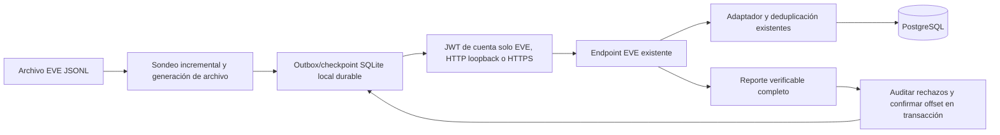

# Monitoreo continuo de archivos Suricata — iteración 11

**Actualización12:** el agente y su checkpoint no cambiaron. El backend incorpora adaptador v2, criticidad de alerta separada del activo y tipo auxiliar de prueba ICMP; [procedimiento y evidencias](NORMALIZACION_SURICATA.md). Se añadió un ensayo posterior con Suricata 8.0.3 en WSL2 sobre PCAP sintético offline. Las afirmaciones de ausencia de ejecución de Suricata de este documento describen la **iteración11**, cuyos resultados se conservan. Cambiar al nuevo archivo dedicado requiere un directorio de estado nuevo, conservando el anterior; no editar/resetear offsets para cambiar la ruta.

Estado: agente experimental de sondeo, validado con **archivos sintéticos** en Windows y Linux/Docker. No se instaló ni ejecutó Suricata, no se abrieron interfaces de captura y no se generó tráfico ofensivo. Fecha de revisión:22-11-2026, America/Mexico_City; registros/evidencias usan UTC o epoch Unix.

## Arquitectura y alcance

`agent/smartir_agent` es un proceso Python independiente con una dependencia directa, httpx 0.28.1. No importa FastAPI, SQLAlchemy, scikit-learn ni los módulos de scoring. Lee bytes de un archivo regular, mantiene outbox/checkpoint SQLite **local del agente** y llama POST `/api/events/import/eve`. El adaptador Suricata, validación, normalización UTC/IP, fingerprint, evidencia, correlación y riesgo siguen en el backend existente; no se duplicaron esos algoritmos. El estado local no sustituye PostgreSQL operacional.



Hay tres actividades diferentes:

1. **Reproducción sintética EVE:** `synthetic.py` escribe ejemplos deterministas de seis categorías, con semilla 202611 y direcciones de documentación/benchmark. No observa red.
2. **Seguimiento automatizado:** el agente lee un archivo que otro proceso escribe. Las pruebas reales HTTP y Docker demuestran este seguimiento y su recuperación, con datos sintéticos.
3. **Captura real por Suricata:** un sensor externo autorizado podría producir EVE; **no fue ejecutada en esta iteración**. Formato compatible no prueba reglas IDS, cobertura, eficacia o captura real.

La interfaz conserva dashboard/fuentes de eventos realmente recibidos. **No añade un indicador conectado/desconectado del agente**: no existe heartbeat remoto verificado. La consola refleja observaciones locales y respuestas aceptadas, no conectividad permanente ni salud del IDS. Una cuenta solo EVE no tiene interfaz interactiva.

## Cuenta de servicio y migración aditiva

Los roles administrador/analista/observador se conservan. Se añade `users.eve_only`, booleano no nulo, default False, mediante **Alembic 0009** posterior a0008. Es necesaria para persistir el privilegio mínimo: un analista ordinario también puede consultar y operar incidentes, lo que excede la necesidad del agente. No se usó una lista de nombres en .env que pudiera perder la restricción al reiniciar.

Administrador crea **un usuario nuevo y dedicado**, con rol analista y eve_only=true, mediante POST `/api/users`. Contraseña local propia de al menos12 caracteres; no se proporciona ninguna predeterminada. Desde OpenAPI, ejecutar un cuerpo equivalente a este esquema, sustituyendo la contraseña **solo en el entorno local**:

```json
{"username":"sensor-lab-agente","role":"analista","eve_only":true,"password":"<SECRETO_LOCAL_NO_PUBLICAR>"}
```

No utilizar esa plantilla literal como contraseña. No cambiar contraseñas existentes para habilitar el agente. `/api/auth/me` añade el campo eve_only. La marca exige rol analista; combinaciones administrador/observador se rechazan422. No puede marcarse como solo EVE un responsable con casos no cerrados sin reasignarlos primero. Tampoco puede asignarse un caso al servicio; se excluye de candidatos elegibles.

El backend consulta rol, activo y eve_only en cada petición. La cuenta solo EVE puede autenticarse y usar **GET `/api/auth/me` y POST `/api/events/import/eve`** entre los endpoints protegidos. Consultas, importación SmartIR, estados, usuarios, reportes, experimentos y ML quedan403; health/OpenAPI siguen públicos para cualquier visitante. Inactividad invalida acceso401. Se revalida autorización en la transacción de ingestión; otros escritores no pueden eludir la restricción ante un cambio concurrente de cuenta. No se confía en un rol/scope enviado por el cliente o guardado en JWT.

La migración solo agrega una columna; todos los usuarios anteriores quedanFalse sin alterar hashes, nombres, roles o activación. No elimina/recrea tablas ni cambia riesgos, modelos, evaluaciones, evidencias o resultados anteriores. Las pruebas de migración comparan las columnas originales y el default nuevo. La BD habitual del usuario **no fue migrada en esta ejecución**: se ensayó exclusivamente en bases aisladas. Los upgrades históricos ahora se prueban hasta0009; no se editaron migraciones0001–0008 ni sus resultados anteriores.

## Configuración y autenticación del proceso

Python 3.11+ en Windows/Linux. Desde la raíz:

```powershell
.venv\Scripts\python -m pip install -r agent/requirements.txt
$env:PYTHONPATH=(Join-Path (Get-Location) 'agent')
$env:SMARTIR_AGENT_USERNAME='sensor-lab-agente'
# Crear un archivo de contraseña local protegido; no mostrar su contenido.
$env:SMARTIR_AGENT_PASSWORD_FILE='C:\ruta-privada\eve-password.txt'
.venv\Scripts\python -m smartir_agent --file C:\laboratorio\eve.json --state-dir C:\laboratorio\estado-agente --api-url http://127.0.0.1:8000 --sensor lab01
```

Linux equivalente:

```bash
python -m pip install -r agent/requirements.txt
export PYTHONPATH="$PWD/agent"
export SMARTIR_AGENT_USERNAME=sensor-lab-agente
export SMARTIR_AGENT_PASSWORD_FILE=/ruta/privada/eve-password.txt
python -m smartir_agent --file /laboratorio/eve.json --state-dir /laboratorio/estado-agente --api-url http://127.0.0.1:8000 --sensor lab01
```

Proteger el archivo secreto con0400/0600 y el directorio de estado con0700 en POSIX; ambos deben ser legibles por el usuario del agente. Se rechazan permisos de grupo/otros en el secreto/directorio local y enlaces simbólicos directos. En Windows, restringir DACL a la cuenta operadora mediante herramientas administrativas: el agente **no valida exhaustivamente ACL NTFS ni cambia permisos del usuario**. No guardar estos archivos en Git. La alternativa `SMARTIR_AGENT_PASSWORD` inyectada por entorno está soportada, pero no ambas fuentes a la vez. Un proceso privilegiado local puede inspeccionar entorno/memoria: no es un gestor de secretos.

La contraseña se lee al autenticar; permite reemplazar el secreto local de una cuenta nueva siguiendo un procedimiento administrativo, sin modificación automática de contraseñas. Un único terminador CR/LF o varios al final del archivo se ignoran; el resto no se normaliza. No pasar contraseña/token en argumentos de línea de comandos. No se escriben en checkpoint, logs, Git o evidencias. Tokens solo en memoria, obtenidos mediante login, renovados30 segundos antes de expirar. Un401 durante envío permite **una** reautenticación y reenvío del mismo lote; credenciales inválidas o un segundo401 detienen el progreso.

El agente verifica auth/me: exige activo, rol analista y eve_only=true. **Se niega a usar administrador o analista ordinario**, aunque pudieran importar. Esta versión requiere backend11 para esa comprobación; el contrato EVE/fingerprints sigue compatible con registros anteriores.

| Opción/variable | Default / límite |
|---|---|
| `--file` / SMARTIR_AGENT_FILE | eve.json; archivo regular estable, no FIFO ni enlace simbólico |
| `--state-dir` / SMARTIR_AGENT_STATE | .smartir-agent; un estado por origen |
| `--api-url` / SMARTIR_AGENT_API_URL | http://127.0.0.1:8000; solo origen, sin usuario, query, fragmento o path adicional |
| `--sensor` / SMARTIR_AGENT_SENSOR | suricata-agent,1–80 caracteres permitidos por la API; mantener estable |
| `--poll` |1segundo; rango .05–300 |
| `--batch-lines` |100líneas físicas,1–100 |
| `--batch-bytes` |512 KiB, mínimo65537 y máximo1 MiB |
| `--rotate-wait` |2 segundos de EOF estable de la generación anterior;0–300 |
| `--max-state-mib` |256 MiB,2–16384; reserva libre mínima64 MiB |
| `--allow-remote-https` |False; habilita explícitamente un origen HTTPS remoto |
| `--ca-file` |CA explícita opcional; sigue verificando hostname/certificado |
| `--once` |Un sondeo/envío acotado; no significa drenar todo el archivo ni garantizar entrega si hay un retry pendiente |
| `--resume-blocked` |Revisión humana y reintento explícito del lote bloqueado, sin cambiar sus bytes |
| `--accept-source-reset` |Solo junto a resume; acepta brecha posible y nueva generación desde byte0, sin lote pendiente |

HTTP se admite únicamente para IP loopback reconocida o localhost. HTTP hacia api,0.0.0.0 u otros hosts se rechaza por defecto; HTTPS remoto requiere autorización explícita de configuración. Nunca se ofrece verify=False. Se ignoran HTTP_PROXY/HTTPS_PROXY y demás variables httpx de entorno mediante trust_env=False; CA personalizada usa la opción explícita. No se siguen redirecciones ni se reenvía un Bearer a otro origen. Respuestas limitadas a128 KiB, solicitadas sin compresión; una codificación comprimida inesperada se rechaza antes de descomprimir.

## Entrega, checkpoints y auditoría

Semántica **al menos una vez**, sin transacción distribuida API/checkpoint. Si el servidor confirma en BD y la respuesta se pierde, el mismo lote se reenvía. Fingerprint EVE existente = namespace/version + sensor estable + JSON original canónico. Evita otro Event; cada aparición EVE puede agregar evidencia, por lo que deduplicación no significa una sola evidencia ni ausencia de nuevas evaluaciones para otros eventos. No se cambian fingerprints históricos SmartIR o Suricata.

Secuencia:

1. Obtener bloqueo exclusivo de `reader.lock` durante toda la vida del proceso. Kernel libera el bloqueo tras caída. Un segundo proceso con el mismo checkpoint falla con código seguro; no se elimina el lockfile para forzar acceso.
2. Identificar archivo por dispositivo/inode real (`os.stat`, también en Windows), no por nombre solamente. El primer arranque lee el archivo actual desde byte0, en lotes; archivos históricos ya presentes no se importan automáticamente y se registra su existencia. Reinicios retoman el offset confirmado, sin releer todo el archivo.
3. Leer solo líneas terminadas en LF, conservando CR, bytes originales, orden y líneas vacías. Una incompleta permanece pendiente en el archivo, sin avance. La próxima lectura repite únicamente ese sufijo acotado. La normalización/validación corresponde a la API.
4. Guardar **antes de enviar** un lote único con UUID, bytes originales, SHA-256, generación, posiciones y líneas absolutas. SQLite usa synchronous=FULL/journalDELETE y un application_id propio; no modifica una BD ajena encontrada como state.db. Verifica checksum/metadatos del pendiente al recuperarlo.
5. Autenticar y enviar el mismo BLOB. Nombre remoto `agent-<generación>-L<línea inicial>-B<UUID lote>.jsonl`; la evidencia del servidor numera líneas relativas al lote, mientras el registro local enlaza offsets y líneas físicas absolutas. La generación y secuencia local conservan orden documental; no se confunde con orden cronológico de event_timestamp.
6. Verificar HTTP200, UUID import_id, complete=true, bytes recibidos exactos, procesados=no vacíos, importados+duplicados+descartados=procesados, motivos coherentes y errors_omitted=0. Un200 no basta por sí solo. Se confía en el servidor configurado; no es una prueba criptográfica independiente de su durabilidad.
7. En **una transacción local**, guardar reporte/auditoría y avanzar offset/línea/ancla. Solo entonces preparar el siguiente lote. Si hay cualquier descarte, retener el lote completo como cuarentena, incluso sus líneas válidas. Esto conserva también los no-alert, que el servidor reporta por motivo agregado sin listar individualmente cada línea. No se salta un rechazo sin registro auditable.

Tablas locales: meta (binding/version/origen/bloqueo), sources (generaciones/offset/ancla), batches (secuencia, request hash, reintentos/deadline/reporte), audit (eventos anexos). Se auditan obtención/renovación de JWT e intento de reautenticación401 sin guardar el token; eve_request_started significa solicitud iniciada, no recepción comprobada. El contador attempts representa ciclos del lote; una renovación401 puede producir dos envíos dentro del ciclo, identificables en audit. El binding fija ruta canónica, API y sensor: cambiarlos requiere otro estado o revisión explícita, nunca transferencia silenciosa. Batches aceptados sin descarte liberan la referencia lógica a su BLOB; los originales permanecen en archivo/servidor. **No es borrado seguro físico** de páginas SQLite. Todo el estado debe protegerse como dato sensible, incluso si ya no hay pendientes. No contiene secretos de autenticación, pero EVE puede contener datos sensibles del sensor.

Consultar con un cliente SQLite local en modo solo lectura, sin publicar BLOB/binding:

```sql
SELECT seq,id,status,start,end,start_line,end_line,attempts,next_attempt,report FROM batches ORDER BY seq DESC LIMIT 20;
SELECT seq,at,code,batch_id FROM audit ORDER BY seq DESC LIMIT 50;
SELECT value FROM meta WHERE key='blocked';
```

El espacio local se limita y se detiene ante capacidad agotada, sin purgar evidencia/cuarentena. Se conservan hasta128 generaciones y se inspeccionan hasta128 candidatos/1000 entradas de directorio; si se excede, revisión humana. No hay archivador automático. Planificar retención, respaldo y ampliación explícita de capacidad antes de llegar al límite. No eliminar el estado para ocultar un error: perderlo obliga a reimportar y puede perder trazabilidad de rechazos. No es portable entre equipos/montajes con identidades de archivo distintas sin un procedimiento explícito.

Un EVE general con mucho flow/otros tipos no-alert genera cuarentena frecuente y puede agotar capacidad. Para operación prolongada, evaluar una salida alert-only configurada por el responsable del sensor y una política de archivo, sin asumir que el agente captura o filtra esos datos por sí mismo. La recuperación de una petición413 exige revisar el contrato/proxy: reducir batch-lines afecta lotes futuros, **no** cambia el pendiente durable. Si hace falta reprocesar en otros lotes, conservar el estado antiguo y hacerlo como procedimiento manual auditado sobre las fuentes retenidas, manteniendo sensor y deduplicación.

## Rotación, truncamiento y recuperación

- **Rename/create:** mantiene identidad de generación anterior, busca el archivo renombrado en el mismo directorio y lo termina antes del nuevo. Con sufijos numéricos recorre `.3→.2→.1→actual`, incluso después de varias rotaciones durante caída. Si falta un eslabón, se bloquea. Un único archivo renombrado no numérico se acepta cuando la sucesión es inequívoca; múltiples candidatos ambiguos se bloquean.
- Espera EOF estable durante rotate-wait; una línea incompleta al rotar bloquea, no se considera un JSON terminado. Mantener archivos rotados disponibles hasta drenaje. Si desaparece la generación activa se registra rotation_gap y se detiene. Si crece un archivo ya retirado y todavía observable, late_retired_growth obliga a revisión.
- **Copytruncate/reescritura:** tamaño menor que offset o cambio del ancla de los últimos128 bytes confirmados detiene el proceso. No puede probar que no hubo pérdida en el intervalo de sondeo. Corregir/recuperar externamente el archivo y, solo tras revisar la brecha, usar resume+accept-source-reset para comenzar una nueva generación en0. Repeticiones válidas se deduplican en el servidor.
- No se leen .gz ni patrones de nombre libre como un colector multiarchivo general. Un archivo por agente/estado. EVE threaded o filenames por fecha requieren instancias/rutas y rotación compatibles administradas explícitamente; no se declara soporte automático de todos los modos de Suricata.

No se garantiza recuperar bytes que el productor elimine/sobrescriba **antes de ser observados**. Una truncación y relleno entre sondeos, con igual identidad/tamaño/ancla, puede ser indetectable. No hay watermark o inotify obligatorio; se necesita un contrato de archivo append-only y retención suficiente. Los bloqueos detectan brechas observables sin inventar recuperación de registros inexistentes. No se alteran archivos fuente para resolver errores.

| Resultado | Comportamiento y checkpoint |
|---|---|
|200 completo/coherente, incluidos rechazos |Guardar reporte y cuarentena si procede; confirmar el rango |
|200 incoherente, JSON inválido, respuesta enorme/comprimida |Bloquear; preservar pendiente/offset anterior |
|401 durante envío |Renovar una vez; segundo401 o login inválido bloquea |
|403/400/404/413/415/422 y otros permanentes |No reintentar automáticamente; auditar código y retener bytes |
|413 parcial |Puede existir prefijo confirmado en servidor; **no** adelantar checkpoint ni dividir silenciosamente. Revisar contrato/límite antes de replay explícito |
|429 |Respetar Retry-After delta o fecha HTTP; si falta/es inválido usar backoff. No aumentar cuotas |
|408/425/500/502/503/504 y fallos de red |Backoff exponencial1–60 s con jitter, o mayor Retry-After válido |
|Retry-After mayor de1 año |Bloqueo para revisión, sin recortarlo y reintentar antes |
|Disco/estado/corrupción/lector duplicado |Salir con código2, sin avanzar ni borrar datos |

Deadline de retry se guarda en epoch y sobrevive reinicio. Esperas son interrumpibles; se reevalúa a lo sumo cada60 s sin enviar antes. Una corrección fuerte del reloj puede afectar plazos: sincronizar el host; el servidor sigue imponiendo su cuota. Una caída tras aceptación remota y antes del commit local produce replay; eso es parte de la semántica declarada. No se probaron cortes eléctricos ni corrupción del dispositivo físico.

## Perfil Docker opcional

`compose.agent.yaml` es un overlay con perfil **eve-agent**. Los tres servicios de compose.yaml no se modificaron. Sin activar el perfil siguen db/api/web. No hay puertos nuevos del agente, captura privilegiada ni montajes de rutas personales por defecto. Volúmenes nuevos agent_input (vacío, solo lectura para agente) y agent_state (durable).

El agente comparte **solo el namespace de red** de api para usar127.0.0.1:8000 de forma local, sin habilitar HTTP remoto inseguro. Ejecuta UID 10001, filesystem raíz de solo lectura, cap_dropALL y no-new-privileges. El volumen de estado inicializa permisos0700. No es un sidecar que pueda ejecutar comandos de respuesta en API.

Preparar la cuenta restringida en la API actualizada y `.env.agent` ignorado, partiendo de `agent/agent.env.example`. Para Compose, inyectar la contraseña por un entorno local protegido o un gestor de secretos; la muestra no contiene valor usable. Un password_file requiere añadir **explícitamente** un montaje de secreto legible por UID 10001 y permisos correctos; no se montan secretos/rutas del usuario automáticamente. `docker inspect`/config expandida pueden exponer entornos: no publicarlos.

```powershell
docker compose -f compose.yaml -f compose.agent.yaml config --quiet
docker compose -f compose.yaml -f compose.agent.yaml --profile eve-agent up --build -d
docker compose -f compose.yaml -f compose.agent.yaml logs --tail 30 eve-agent
```

Para un archivo real autorizado, añadir un overlay **local no versionado** como `.env.agent-mount.yaml` (ignorado por .env.*), sustituyendo el volumen de entrada con `!override`, y sin cambiar el volumen de estado:

```yaml
services:
  eve-agent:
    volumes: !override
      - type: bind
        source: /ruta/explicita/al/directorio/suricata
        target: /input
        read_only: true
      - agent_state:/state
```

Montar **directorio**, no un único archivo: el agente necesita observar rename/create. En Windows usar una ruta compartida válida para Docker Desktop y confirmar permisos/identidades; no se probó un bind de logs reales. Añadir ese archivo con otro `-f` solo tras autorización y revisión de su contenido. No publicar la ruta/secretos.

Si se recrea el contenedor API, recrear/reiniciar también el agente según el cambio de namespace; no asumir que una instancia atada al contenedor anterior encontrará el nuevo. No se usa restart automático para esconder fallos permanentes. Un supervisor de SO debe preservar estado y requerir revisión ante salida2. No ejecutar down-v, prune ni cambiar la contraseña del volumen existente al actualizar.

## Laboratorio reproducible sin IDS ni datos reales

Crear una instancia nueva y archivos privados. El escritor no sobreescribe un archivo existente salvo append explícito:

```powershell
$env:PYTHONPATH=(Join-Path (Get-Location) 'agent')
New-Item -ItemType Directory -Force .test-runs/lab11 | Out-Null
.venv\Scripts\python -m smartir_agent.synthetic --file .test-runs/lab11/eve.json --seed 202611 --count 60 --interval .2
# En otra terminal, con cuenta SOLO de esa API aislada:
.venv\Scripts\python -m smartir_agent --file .test-runs/lab11/eve.json --state-dir .test-runs/lab11/estado --api-url http://127.0.0.1:PUERTO_AISLADO --sensor lab11
```

Sustituir PUERTO_AISLADO por el puerto efectivo. Para seguir escribiendo usar `--append --start-index 60`; repetir índices produce duplicados intencionales. El timestamp sintético comienza2026-01-01UTC: seleccionar ese periodo/eje de evento en dashboard. Severidad deriva del generador; criticidad EVE50 y contexto50 son políticas no observadas. No interpretar enero→recepción actual como MTTD.

Runners automatizados no aceptan una BD/URL operacional arbitraria. PostgreSQL de prueba en127.0.0.1:55440/smartir_validation, tmpfs sin volúmenes existentes; cada ejecución crea schemaUUID. La confianza local de este contenedor es **solo para laboratorio**.

```powershell
docker run --name smartir-iter11-pg --label smartir.validation=iter11 --rm --tmpfs /var/lib/postgresql/data -e POSTGRES_HOST_AUTH_METHOD=trust -e POSTGRES_DB=smartir_validation -p 127.0.0.1:55440:5432 -d postgres:16-alpine
docker exec smartir-iter11-pg pg_isready -U postgres -d smartir_validation
.venv\Scripts\python -m pytest backend/tests -q -p no:cacheprovider --basetemp .test-runs/replay11-sqlite
$env:TEST_DATABASE_URL='postgresql+psycopg://postgres@127.0.0.1:55440/smartir_validation'
.venv\Scripts\python -m pytest backend/tests -q -p no:cacheprovider --basetemp .test-runs/replay11-pg
Remove-Item Env:TEST_DATABASE_URL
.venv\Scripts\python -m validation.run_agent --database sqlite --label replica
.venv\Scripts\python -m validation.run_agent --database postgresql --label replica
.venv\Scripts\python -m validation.compose_agent_smoke
Push-Location frontend
npm run build
Pop-Location
```

Usar etiquetas nuevas para conservar evidencia. Los schemas de runner quedan mientras viva el PostgreSQL temporal; pytest solo retira sus propios schemas UUID. El runner Compose crea proyecto/volúmenes nuevos, arranca y detiene exclusivamente ese proyecto, sin eliminar volúmenes. Los puertos de ensayo58011/55181 deben estar libres. No ejecutar estos comandos apuntando al PostgreSQL habitual.

## Pruebas y resultados reales

| Nivel/caso | Resultado comprobado |
|---|---|
|Suite final SQLite|**164 passed**,0 fallos,154.44 s |
|Suite final PostgreSQL 16.16|**164 passed**,0 fallos,223.91 s |
|Casos nuevos del agente|38 casos parametrizados: lectura, incompletas, reinicio/outbox, rotación múltiple, truncamiento, exclusión, bindings, TLS/config, secretos, corrupción, cuotas/errores/renovación, API real y migración |
|HTTP TCP Windows→SQLite y Windows→PostgreSQL|Proceso agente independiente;12 eventos/6 tipos,5 lotes,2 generaciones,1cuarentena con2 descartes, reinicio y caída real de API; replay12 duplicados;25 apariciones de evidencia; segundo lector rechazado |
|Docker/Linux|Perfil opcional, UID 10001 comprobado, raíz readonly, sin host mounts; reinicio sin replay, rotación,12 eventos/13 evidencias,3 lotes y1cuarentena; head 0009,health/web200; volúmenes preservados |
|Build React/TypeScript|442 módulos,7.67 s; correcto |

Se conserva una advertencia TestClient/httpx de Starlette, sin fallos finales. Hay pruebas mock HTTP401/403/413/429/503, fechas Retry-After y renovación; **no se presentan como respuestas medidas de un IDS o de una red remota**. Los recorridos TCP sí incluyen caída real de Uvicorn/conexión rechazada, recuperación, autenticación restringida y adaptador real. La pérdida de respuesta después del commit se inyecta en un transporte de prueba contra la API aislada; comprueba2events/4 evidencias al replay sin duplicar Event.

Las duraciones de fases JSON incluyen espera de condición, sondeo, autenticación y procesamiento en host compartido. No son un benchmark de latencia estricta, MTTD, MTTR o productividad humana. El default1 s no garantiza entrega≤1 s: se suman flush del productor, lectura, procesamiento, cuotas, red y backoff.

Evidencias reales en docs/resultados: `iter11_agent_http_{sqlite,postgresql}_auditado.json/.csv` del código con trazabilidad final; ejecuciones run1/cierre previas conservadas, JSON de tres proyectos de perfil Compose y uno base, resumen JUnit `iter11_validacion_cierre.json` y hashes históricos. La primera suite final anterior a los eventos de transporte también pasó164 casos por base (114.67/153.48 s), conservada en `iter11_validacion_final.json`. La repetición final154.44/223.91 s coincidió con otros runners aislados en el host; no se compara como mejora/regresión de rendimiento. Los receipts enlazan import_id/generación/UUID lote/offsets/códigos; no contienen BLOB de cuarentena, contraseñas ni JWT. Los checkpoints y logs completos permanecen fuera de Git. No se generaron capturas de red ni imágenes ficticias. No hubo una nueva campaña Playwright en11; la de10 sigue siendo evidencia histórica de esa versión.

Fallos corregidos: primera suite del agente21 fallos/12 aciertos por st_ino vacío de DirEntry en Windows; os.stat resolvió la causa común. Otra ejecución37 aciertos/1fallo se debió al mock de compresión que descomprimía al construir Response; se cambió a stream crudo para probar el comportamiento real. Los intentos fallidos no se cuentan como aprobados ni se publican sus cuerpos/credenciales sintéticas de traceback. Se añadió además verificación de spool/BD ajena y manejo de reset conservando identidad física sin falsas alarmas posteriores.

## Archivos, contratos y limitaciones pendientes

Nuevos: paquete/requirements/Dockerfile del agente, ejemplo sin secretos, compose.agent.yaml, migración0009, test_agent.py, runners TCP/Compose/colector y esta especificación. Cambios puntuales: User.eve_only, auth/me, administración/guards de asignación y actor; paso de autorización EVE al ingest compartido; mensaje de cuenta restringida en login React; fixtures y expectativas de head/proyección de columnas antiguas. `.gitignore` protege estado/secreto; atributos Git conservan CSV11. POST EVE no cambió formato, adaptador, límites, algoritmo ni fingerprint.

Límites: un archivo regular append-only y origen confiable por estado; patrones de rotación descritos, retención requerida, ancla acotada, no recuperación de datos nunca observados, capacidad local finita y revisión de cuarentena; no filesystem remoto/NFS o locks distribuidos probados, no hardening frente a administrador local malicioso, sin cifrado automático del estado, sin validación exhaustiva de DACL Windows. HTTPS/CA se configuran con verificación activada, pero no se ensayó un despliegue remoto/proxy/PKI productivo. Timeout de conexión5 s/lectura30 s por operación; no hay deadline extremo a extremo, y una señal de parada no cancela inmediatamente una llamada HTTP bloqueante. Rate limiting sigue por proceso en backend. El sensor_id es declarado: JWT autentica la cuenta, no atestigua hardware, veracidad EVE o pertenencia exclusiva a un sensor. No hay heartbeat remoto, captura IDS, eficacia real ni garantía temporal estricta. Deben ensayarse sensor real autorizado, su rotación/flush, retención y operación prolongada antes de ampliar el alcance.

Referencias primarias consultadas22-11-2026: [Suricata8.0.1, EVE/file output y rotación](https://docs.suricata.io/en/suricata-8.0.1/output/eve/eve-json-output.html), [HTTPX SSL](https://www.python-httpx.org/advanced/ssl/), [HTTPX entorno/proxies](https://www.python-httpx.org/environment_variables/). Describen el formato/configuración, no acreditan una captura ni validación de este prototipo en producción.
