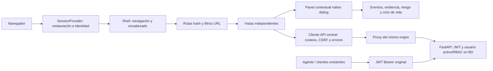

# Iteración 13 — espacio de operaciones y sesión web

Estado: implementación para revisión. La documentación histórica01–12 se conserva. Esta iteración reorganiza la experiencia de usuario y añade transporte de sesión web seguro; no cambia scoring, correlación, Suricata, datasets, ML ni evaluaciones congeladas. El head real sigue **0009**, sin migración nueva.

## Inspección y defectos encontrados

Se revisaron main.tsx, CSS, los cinco módulos existentes, endpoints, JWT/Argon2id/RBAC, RequestGuard, esquemas, pruebas y runners. El JWT se conservaba en `useState('')`: una recarga creaba otro árbol React sin token. Toda la aplicación se montaba bajo la misma página; el detalle quedaba después del dashboard, importación, evaluación y ML. El CSS global no establecía una estructura de navegación ni contenía todas las tablas al reducir el viewport. Estos hechos explican la pérdida de sesión y la distancia al incidente seleccionado.

No se instaló otro framework ni se sustituyó el stack. Se reutilizan los contratos y módulos operativos. El cambio de autenticación se limita al transporte de navegador, porque persistir el JWT en localStorage/sessionStorage habría expuesto la credencial a JavaScript del origen.

## Arquitectura actual



`main.tsx` queda como punto de montaje. `App.tsx` aplica la protección de rutas. `auth/SessionProvider.tsx` restaura la identidad y controla expiración. `api.ts` centraliza solicitudes/descargas y errores401/403/409/422/429. `navigation.ts` maneja rutas hash, historial del navegador y query. `components/` reúne Shell, filtros, tabla, panel de incidente, evidencia y elementos de diseño. `pages/` separa resumen, incidentes, login e importación. Analítica, evaluación y ML se cargan por sección; estos tres módulos usan chunks diferidos.

La navegación hash permite abrir enlaces y recargar con el servidor estático/Vite actual sin reglas de reescritura nuevas. Hay seis rutas permitidas, una pantalla para desconocidas y control de rol para importación. No se añadió una dependencia de router para esta superficie acotada. No sustituye autorización de servidor: acceder por URL o llamar directamente a FastAPI sigue sujeto a RBAC.

## Rutas y contexto de trabajo

| Ruta | Contenido | Permisos |
|---|---|---|
| #/dashboard | Seis indicadores, actividad de30 días y seis incidentes recientes | Tres roles interactivos |
| #/incidents | Filtros combinables, tabla, paginación y apertura contextual | Consulta por los tres roles; escritura según backend |
| #/analytics | Tendencias, métricas, snapshots JSON/CSV/PDF, comparación registrada | Consulta; snapshots para escritores; comparación con referencias solo administrador |
| #/import | Formato, sensor, archivo, confirmación explícita y reporte | Administrador/analista; observador403 |
| #/evaluation | Datasets/experimentos conservados; comparación reproducible | Restricciones anteriores; referencias y ejecución solo administrador |
| #/ml | Versiones, inferencia, comparación y entrenamiento experimental | Inferencia/consulta existente; gestión/etiquetas solo administrador |

Los filtros aplicados y la página de incidentes viven en la query del hash. `incident=<UUID>` abre un panel sin abandonar la tabla. Recargar vuelve al mismo caso después de verificar identidad. Atrás restaura la URL anterior; cerrar el panel elimina ese parámetro, conserva filtros y devuelve el foco al botón de origen si sigue en el DOM. La barra recuerda la URL visitada de cada sección durante el montaje actual. Los borradores de formulario no se guardan en disco: navegar fuera de una sección puede descartarlos. Los filtros explícitos del enlace sobreviven a recarga; no se guardan tokens en URL.

El resumen usa creación del incidente en últimos30 días UTC, no pretende total histórico. Usa el periodo predeterminado calculado por la API con precisión completa. En formularios de minuto, el fin predeterminado se redondea al minuto siguiente (y se muestra así), para incluir los casos recién recibidos; truncarlo hacia abajo omitía el minuto actual. El detalle y la cola muestran prioridad/estado/responsable actuales. Analítica e incidentes reutilizan los filtros de cohortes existentes: inicio incluido, fin excluido y eje elegido (creación, evento o recepción). El periodo no se convierte silenciosamente al tiempo local. JSON/CSV/PDF conservan su cohorte/denominadores del backend.

## Sesión: estrategia y controles de seguridad

Se mantiene el JWT existente de **900 segundos**, firma HS256, issuer/audience y Argon2id. La API recibe un transporte adicional por cookie **smartir_session**, HttpOnly, SameSite=Strict, Path=/api, host-only, Max-Age900. No hay refresh token ni renovación silenciosa: GET de restauración informa el vencimiento original. `Secure` se activa para solicitudes HTTPS; HTTP solo se admite en loopback. Se ignoran X-Forwarded-* como prueba de TLS. Un host remoto por HTTP se rechaza. Es una excepción deliberada para el prototipo local, no una configuración para Internet.

HttpOnly reduce la lectura de la credencial desde JavaScript; no neutraliza una ejecución XSS capaz de actuar en la sesión. SameSite es defensa adicional, no el único control CSRF. Se usan comprobación exacta de Origin y cabecera personalizada para operaciones de cookie, conforme a principios de [gestión de sesión OWASP](https://cheatsheetseries.owasp.org/cheatsheets/Session_Management_Cheat_Sheet.html) y [prevención CSRF OWASP](https://cheatsheetseries.owasp.org/cheatsheets/Cross-Site_Request_Forgery_Prevention_Cheat_Sheet.html). La cookie se emite mediante [Response.set_cookie de FastAPI](https://fastapi.tiangolo.com/advanced/response-cookies/).

| Control | Decisión implementada |
|---|---|
| Restablecimiento tras recarga | GET /api/auth/session verifica JWT y usuario activo en BD; React espera esa respuesta antes de mostrar contenido protegido |
| Protección CSRF | Toda mutación autenticada por cookie exige Origin permitido y X-SmartIR-CSRF:1. Login y logout web también. No se trata ese marcador público como secreto; se apoya en SOP/CORS, Origin y SameSite |
| Orígenes | Mismo origen visto por FastAPI y lista exacta SMARTIR_WEB_ORIGINS (por defecto localhost/127.0.0.1:5173). Nunca wildcard ni coincidencia por prefijo |
| Proxy | Vite conserva Host y reenvía /api. El navegador usa rutas del mismo origen; no necesita leer ni enviar manualmente un token |
| Credenciales | Contraseña solo en el formulario durante el envío y borrada al terminar. JWT fuera de localStorage/sessionStorage/URL/React; cookie HttpOnly |
| Roles y baja de usuario | current_user consulta BD en cada petición. Bearer explícito inválido no cae a una cookie válida. La marca eve_only impide login interactivo |
| Expiración | Temporizador con segundos restantes de API, comprobación al volver al foco/visibilidad y salida ante401; no se extiende al recargar |
| Caída de API | Pantalla de verificación fallida y reintento. No se borra la cookie por un fallo de red ni se afirma sesión válida sin comprobarla |
| Solicitudes antiguas | Generación de sesión/solicitudes impide que un401 pendiente anterior invalide una identidad nueva |
| Logout | DELETE protegido elimina cookie con mismo path/atributos; React borra identidad y desmonta datos. Si falla la API se informa y permite reintentar |
| Cache y trazas | RequestGuard conserva no-store, cabeceras defensivas y errores sin valores de entrada. No se habilitan HAR, vídeo ni storageState de navegador |
| Rate limiting | POST sesión web y POST login Bearer comparten la cuota por peer y admisión Argon2;429 incluye Retry-After. No se elevaron límites |

La sesión es **JWT sin tabla de revocación**. Logout elimina la credencial del navegador actual; una copia robada de un JWT emitido no se revoca por ese acto y puede ser válida hasta expirar. Desactivar un usuario bloquea su uso porque la BD se consulta. No se añadió una lista en memoria que aparentara revocación fiable entre procesos. Esta limitación y el alcance local deben revisarse antes de un despliegue productivo; no se amplió a un sistema de refresh/revocación de credenciales.

Los cookies no se aíslan por puerto. Otros servicios no confiables en el mismo host local son parte del riesgo del entorno de laboratorio. Un despliegue remoto requiere dominio dedicado, HTTPS y configuración explícita de proxy/TLS y Origin; no basta con reenviar X-Forwarded-Proto. El frontend actual de Compose sigue siendo Vite de desarrollo, no un servidor productivo endurecido.

## Contratos de backend y despliegue local

| Endpoint | Contrato |
|---|---|
| POST /api/auth/login | **Sin cambios**: access_token, token_type, expires_in; agente y clientes Bearer intactos |
| GET /api/auth/me | Conserva identidad/RBAC; también acepta cookie válida |
| POST /api/auth/session | Nuevo; LoginIn anterior, CSRF/Origin. Devuelve user, expires_at epoch UTC y expires_in; JWT solo en Set-Cookie |
| GET /api/auth/session | Nuevo; identidad y vencimiento de cookie, sin extenderlo ni retornar JWT |
| DELETE /api/auth/session | Nuevo;204 y eliminación de cookie, incluso si ya expiró; requiere controles CSRF |
| Endpoints operativos anteriores | Conservan cuerpo, respuesta, límites y RBAC. Cookie validada es un transporte adicional; Bearer no exige cabecera CSRF |

El cliente de interfaz usa `VITE_API_URL` vacío/ausente (mismo origen). Vite tiene un proxy /api a127.0.0.1:8000 para ejecución local. Compose añade al servicio web **solo** `SMARTIR_API_PROXY_TARGET=http://api:8000` para resolver el servicio desde el contenedor. No cambia puertos, usuarios, volúmenes ni contraseñas. La URL de proxy es configuración del servidor, no una variable VITE que deba enviarse como credencial. Si se servirá dist con otro servidor, configurar allí el proxy /api; `vite build` no empaqueta un proxy de producción.

```powershell
# Pruebas fuera de la base habitual. Las fixtures usan SQLite temporal o schemas UUID.
.venv\Scripts\python -m pytest backend/tests -q -p no:cacheprovider `
  --basetemp .test-runs/iter13-sqlite-nueva --junitxml=.test-runs/iter13-sqlite-nueva.xml
# PostgreSQL: contenedor NUEVO sin volumen persistente, solo loopback; no reutilizar BD operativa.
docker run --name smartir-iter13-pg --label smartir.validation=iter13 --rm `
  --tmpfs /var/lib/postgresql/data -e POSTGRES_HOST_AUTH_METHOD=trust `
  -e POSTGRES_DB=smartir_validation -p 127.0.0.1:55440:5432 -d postgres:16-alpine
$env:TEST_DATABASE_URL='postgresql+psycopg://postgres@127.0.0.1:55440/smartir_validation'
.venv\Scripts\python -m pytest backend/tests -q -p no:cacheprovider `
  --basetemp .test-runs/iter13-pg-nueva --junitxml=.test-runs/iter13-pg-nueva.xml
Remove-Item Env:TEST_DATABASE_URL
Push-Location frontend
npm ci
npm run build
Pop-Location
# Playwright usa credenciales efímeras en memoria, nuevas bases y puertos propios.
.venv\Scripts\python -m validation.run_frontend13 --database sqlite --label nueva
.venv\Scripts\python -m validation.run_frontend13 --database postgresql --label nueva
# Recorrido histórico adaptado a rutas/panel; conserva comprobaciones funcionales.
.venv\Scripts\python -m validation.run_integral --database postgresql --browser --iteration 13 --label nueva
# Arranque independiente; solo detiene su propio proyecto, no elimina volúmenes.
.\validation\compose_smoke.ps1 -Iteration 13 -ExpectedHead 0009
```

Antes de activar la nueva interfaz en una instalación existente, revisar/respaldar el despliegue habitual. En esta validación no se reconstruyeron ni reiniciaron sus tres servicios. La configuración de desarrollo/Compose debe actualizarse junto al backend de sesiones; un frontend13 contra backend12 responderá404 en las rutas de sesión, no un login compatible. No requiere migrar datos ni alterar el agente. Si ya se utiliza otro proxy, conservar Host o configurar el origen exacto aprobado; un rechazo CSRF no se corrige aceptando cualquier origen.

## Panel, evidencia y sistema de diseño

La barra lateral organiza el trabajo; el encabezado muestra usuario/rol y cierre, sin inventar conectividad del agente. El dashboard se limita a lo relevante; investigación, ingestión y reportes no compiten por el mismo espacio. Tokens CSS definen superficies oscuras, tipografía, borde, acento, prioridad, foco y estados. Componentes comunes proporcionan PageTitle, Badge, Notice, Empty, Loading, Tabs y JsonViewer. Las animaciones de gráficas no son necesarias para interpretar datos y se desactivan para estabilidad visual; tooltips conservan interactividad.

El panel usa `dialog.showModal`, fondo inerte, bloqueo de scroll del documento, Escape y retorno de foco. Un control explícito mantiene Tab/Shift+Tab dentro del diálogo. La actualización de revisión mantiene el formulario montado y deshabilita edición durante la carga: no se pierde lo tecleado por un remonte intermedio. Los errores409 conservan el contexto y ofrecen recargar revisión antes de intentar de nuevo. No se sustituyen expected_revision ni reglas de estado/responsabilidad por validaciones únicamente visuales.

Resumen y riesgo, eventos/evidencias y gestión/historial son pestañas del caso. Gestión distingue respuesta, historial y tiempos. La lista de eventos pagina20; evidencia pagina10 apariciones. Los registros originales y las políticas se abren en bloques técnicos acotados y seleccionables, con líneas largas ajustadas; no se colocan al final de toda la aplicación. Se distinguen ausencia de evidencia histórica y valores no calculables.

La información Suricata12 se conserva: firma/SID, prioridad ordinal original3, índice de alerta derivado40 Media, activo50 predeterminado/no observado y tipo auxiliar prueba_icmp. Sigue la advertencia de que firma declarada y score genérico no prueban ataque ni impacto. JSON y procedencia preservan la evidencia; no se normalizan de nuevo filas antiguas desde React.

## Verificación y evidencia

Las cifras y artefactos finales están en [índice13](resultados/README_ITER13.md). Se diferencian suites pytest, casos de navegador, datos sintéticos y capturas auténticas. No hay tráfico capturado, mediciones humanas, benchmark de throughput ni nuevos resultados de eficacia ML en esta iteración.

Se probaron recarga válida por tres roles, cookie HttpOnly, almacenamiento JS vacío, filtros/rutas, panel, originales/procedencia, asignación/transición/acción y409, logout persistente y expiración real de un JWT de5 segundos firmado **solo con la clave de la instancia aislada**. Los tests no alteran la duración operativa900s: el JWT corto es una fixture para comprobar el reloj y el rechazo del backend. Se probaron422/429 reales; el arnés histórico conserva SmartIR/EVE, dedup, reapertura/reevaluación, reportes y ML del recorrido previo.

Se comprueban1440/820/390px, ancho del documento, ajuste del panel, foco/Escape y pares de colores del diseño con fórmula WCAG (luminancia relativa y `(Lmayor+.05)/(Lmenor+.05)`, umbral4.5 para texto normal). Es una verificación acotada, no una certificación de accesibilidad. No sustituye pruebas con lector de pantalla, Safari/Firefox, zoom extremo, todos los colores de gráficos o revisión humana completa. Tablas anchas pueden desplazarse dentro de su región, sin ampliar el documento.

Incidencias encontradas durante el cierre: proxy del arnés que reescribía Host (login CSRF403); prueba de foco que detectó salida del diálogo; texto accesible absoluto que ampliaba el documento móvil; carrera entre recarga del detalle y edición del formulario. Se corrigieron sin relajar origen ni permisos. Las pruebas históricas se adaptaron a navegar y cerrar el diálogo antes de logout; una petición que pretendía ser anónima ahora especifica credentials:omit, porque sin ello la cookie la autentica legítimamente. Se conservan sus aserciones de errores, roles, acciones, importación y exportaciones.

## Limitaciones y revisión

Archivos cambiados por responsabilidad (los artefactos individuales están indexados en resultados):

| Grupo | Archivos |
|---|---|
| Sesión backend | backend/app/main.py, security.py, abuse.py y nuevo web_session.py; backend/tests/test_web_session.py |
| Entrada y sesión React | frontend/src/main.tsx, App.tsx, api.ts, navigation.ts, types.ts, auth/SessionProvider.tsx |
| Diseño y contexto | frontend/src/style.css; components/Shell.tsx, ui.tsx, IncidentFilters.tsx, IncidentTable.tsx, IncidentDrawer.tsx, EvidenceViewer.tsx; hooks/useCohort.ts |
| Páginas y módulos conservados | pages/Login.tsx, Dashboard.tsx, Incidents.tsx, ImportEvents.tsx; AnalyticsDashboard.tsx, IncidentLifecycle.tsx, Evaluation.tsx, MachineLearning.tsx |
| Proxy local | frontend/vite.config.ts, compose.yaml |
| QA de navegador | frontend/tests/frontend13.config.ts, frontend13.spec.ts; adaptación de integral.spec.ts, suricata12.spec.ts y vite.validation.ts |
| Runners y manifiesto | validation/run_frontend13.py, collect_frontend13.py; extensión compatible de run_integral.py, run_suricata12.py y compose_smoke.ps1 |
| Documentación | README.md, esta guía, GUIA_USUARIO, GUIA_DESPLIEGUE, ANTologia_implementacion, índice13, evidencia JSON/CSV/PNG/PDF y .gitattributes |

No se cambian package.json/package-lock.json ni requirements del backend. SuricataEventDetails y los algoritmos/modelos de servidor se reutilizan sin modificarlos. Se verificaron88 artefactos históricos y43 archivos conservados de código/dependencias; el manifiesto detalla cada comparación y los casos de equivalencia de finales de línea.

No hay validación productiva/externa, refresh ni revocación centralizada. Se requiere proxy del mismo origen para la interfaz. Los borradores de formulario no persisten al abandonar una sección. La validación de contraste cubre pares definidos, no cada combinación de datos. No se certifica lector de pantalla ni navegadores fuera de Chromium. Los experimentos/ML siguen siendo prototipos con limitaciones históricas. La funcionalidad y datos habituales del usuario no se usan como fixtures; las capturas son de cuentas y datos sintéticos aislados.

La antología continúa en revisión. Las prácticas Packet Tracer conservan su estado diseñado, sin implementación ni capturas nuevas atribuibles a esta iteración.
