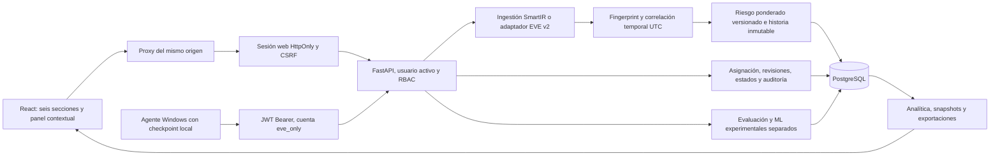

# Iteración14 — validación integral y cierre técnico para revisión

Fecha de ejecución:22-11-2026, America/Mexico_City; evidencias con timestamps UTC. Repositorio Dylan-Daza-Celis/SmarT-Net, base644cc4f. No constituye aprobación académica final, certificación de seguridad ni declaración de preparación para Internet.

## Alcance y arquitectura vigente

Se inspeccionaron autenticación/cookies, RequestGuard, dependencias de autorización, controladores, SQLAlchemy, normalización, ciclo de vida, frontend13 y runners existentes. Se preservan FastAPI, PostgreSQL16, SQLAlchemy, Alembic0009, React/TypeScript, Recharts, JWT/Argon2id, scikit-learn y agente Python independiente. No se requiere migración14 ni cambio del esquema. Las cinco prácticas Packet Tracer no se modifican.



La sesión web usa cookie HttpOnly/SameSite Strict, host-only y path/api; Secure en HTTPS, HTTP permitido solo en loopback. El TTL absoluto es900s, sin refresh. Origin exacto y cabecera personalizada protegen mutaciones por cookie. Bearer sigue disponible para agentes/clientes. La identidad, rol y activación se consultan en BD. Una cuenta eve_only queda restringida a su identidad/importación EVE. No se almacenan tokens en localStorage/sessionStorage.

Logout elimina la cookie del navegador; un JWT copiado conserva validez hasta expirar, salvo desactivación del usuario. No hay revocación centralizada. CORS, Host y rate limiting conservan las restricciones existentes; la cuota en memoria es por proceso, no distribuida. Un proxy puede concentrar peers. No se confía en cabeceras forwarded para justificar TLS. El despliegue actual es local con Vite, no un servidor web productivo endurecido.

## Metodología y reproducibilidad

Las suites usan SQLite temporal y PostgreSQL16 desechable en127.0.0.1:55440, con schemas UUID. Los recorridos levantan procesos API en puertos loopback nuevos y credenciales generadas en memoria. Compose usa un nombre/proyecto/volumen nuevos y solo detiene ese proyecto. No se migra, carga ni limpia la base habitual. No se utiliza downgrade ni eliminación de volúmenes.

Los runners anteriores reciben un parámetro opcional de iteración14, conservando sus defaults. No se reconstruyen funcionalidades. Las pruebas de navegador mantienen seis casos de13, más los recorridos integral y Suricata; capturas reales, sin HAR/vídeo/storageState. La red está limitada al origen de prueba. Un aborto de red deliberado comprueba recuperación; no se presenta como caída medida del servidor.

Comandos desde la raíz (usar nombres/labels nuevos en repeticiones):

```powershell
docker run --name smartir-iter14-pg --label smartir.validation=iter14 --rm `
  --tmpfs /var/lib/postgresql/data -e POSTGRES_HOST_AUTH_METHOD=trust `
  -e POSTGRES_DB=smartir_validation -p 127.0.0.1:55440:5432 -d postgres:16-alpine
.venv\Scripts\python -m pytest backend/tests -q -p no:cacheprovider `
  --basetemp .test-runs/iter14-sqlite --junitxml=.test-runs/iter14-sqlite.xml
$env:TEST_DATABASE_URL='postgresql+psycopg://postgres@127.0.0.1:55440/smartir_validation'
.venv\Scripts\python -m pytest backend/tests -q -p no:cacheprovider `
  --basetemp .test-runs/iter14-pg --junitxml=.test-runs/iter14-pg.xml
Remove-Item Env:TEST_DATABASE_URL
npm ci --prefix frontend
npm run build --prefix frontend
.venv\Scripts\python -m validation.run_frontend13 --iteration 14 --database sqlite --label final
.venv\Scripts\python -m validation.run_frontend13 --iteration 14 --database postgresql --label final
.venv\Scripts\python -m validation.run_integral --iteration 14 --database postgresql --browser --label final
.venv\Scripts\python -m validation.run_agent --iteration 14 --database postgresql --label final
.\validation\compose_smoke.ps1 -Iteration 14 -ExpectedHead 0009
```

El trust de PostgreSQL pertenece exclusivamente a esa instancia efímera loopback; no es una configuración operativa recomendada. La ejecución de offline WSL sigue `validation/suricata_offline_wsl.py`, con directorio nuevo `.test-runs/iter14-engine`; solo -T y -r, nunca una interfaz. Posteriormente `validation.run_suricata12 --iteration 14 --source-dir .test-runs/iter14-engine --database postgresql --browser --label final` recorre agente/API/UI. El colector14 sanea JUnit y verifica evidencia/compatibilidad; nunca sobrescribe artefactos anteriores.

## Matriz de trazabilidad

| Requisito | Componentes | Prueba y evidencia |
|---|---|---|
| Autenticación, JWT y expiración | security, web_session, SessionProvider |test_api, test_web_session; E2E cookie y JWT fixture5s, restore/logout |
| Roles y autorización independiente de UI | current_user, require_roles y controladores |test_final_audit inventaría operaciones API sin identidad y exportaciones vedadas a operadores; suites previas |
| Cuenta de servicio | eve_only, agente y auth |test_agent, test_final_audit; agente Windows real por TCP con cuenta restringida |
| CSRF, Origin, Secure y errores seguros | web_session, RequestGuard |test_web_session y test_security_controls; HTTPS simulado por TestClient, no PKI productiva |
| Límites y JSON/JSONL inválido | validación, eve_import |test_security_controls, test_suricata y test_agent |
| SQL seguro y conservación | SQLAlchemy/cohortes |Filtro con metacaracteres SQL permanece literal y conserva conteos; no es un escaneo exhaustivo |
| Correlación/riesgo e historia | correlation, risk, ingestion |test_temporal_risk, test_suricata12, journey integral y evaluaciones congeladas |
| Asignación, transición y concurrencia | lifecycle, reassessment, main |test_lifecycle, test_integral; E2E409, acciones/historia y reinicio |
| EVE v2 y criticidades | suricata, suricata_policy |test_suricata12 y pipeline offline: firma/SID/prioridad,40 Media vs activo50 no observado, score genérico sin recalibrar |
| Dedup/checkpoint/reinicio/rotación | agente y evidence |test_agent y runner TCP con archivos sintéticos y API detenida/reiniciada |
| Analítica y reportes | analytics y analytical_reports |test_analytics y journey: filtros, JSON/CSV/PDF y conservación del snapshot tras reinicio |
| Evaluación y ML | experimentos y pipelines scikit-learn |test_evaluation, test_ml; generación/entrenamiento de fixtures del journey, sin cambiar modelos existentes |
| Seis vistas, panel, filtros y evidencia | frontend13 |Playwright: recarga, rutas, Escape/Tab, Enter, estados y roles; capturas auténticas |
| Responsive/accesibilidad básica | CSS y componentes UI |390/820/1440px, documento sin overflow, foco y cuatro pares de contraste>=4.5; no certificación WCAG |
| Infraestructura y conservación | Compose, Alembic, PostgreSQL |Imágenes, health, web/proxy, restart de db/api/web y usuario/cookie preservados; journey compara todas sus tablas |
| Histórico y Packet Tracer | archivos originales |Comparación Git con644cc4f; ninguna modificación de prácticas, algoritmos o migraciones |

El aislamiento verificado es **RBAC y restricciones de escritura**, no tenancy. Los roles humanos consultan la cola SOC compartida; no existe separación por organización ni propiedad privada de cada incidente. No se atribuye al prototipo esa capacidad inexistente.

## Resultados, hallazgos y límites

Cifras reales, versiones, comandos, capturas y estados finales: [README_ITER14](resultados/README_ITER14.md), [manifiesto JSON](resultados/iter14_validacion.json) y CSV. Los fallos de herramientas/ejecuciones, si ocurren, se registran aparte y no se cuentan como pruebas aprobadas. No se cambian algoritmos ni se añaden funciones operativas para justificar esta iteración.

Se conservan los riesgos ya identificados en13: JWT sin revocación centralizada, cookie compartida por puertos del mismo host, dependencia de origen/proxy correcto, Vite local, rate limiting por proceso, navegador Chromium únicamente y accesibilidad parcial. La advertencia TestClient/httpx existente no equivale a un fallo de pruebas. No hay auditoría externa ni garantía de ausencia de vulnerabilidades.

Las pruebas ejercitan SQL y PostgreSQL reales en entorno aislado; no acreditan resistencia a toda inyección, aislamiento multi-tenant, alta disponibilidad ni carga productiva. La cuenta eve_only no es un sensor autenticado criptográficamente: sensor_id sigue siendo procedencia declarada.

Se distinguen: (1) JSON sintético construido, (2) motor Suricata8.0.3 ejecutado offline con PCAP construido, (3) seguimiento real de archivos por agente/API, (4) captura real previamente comunicada por el usuario. Solo las tres primeras son reproducidas por la automatización de este cierre. La cuarta no se certifica ni se inventan capturas/evidencias adicionales.

## Rendimiento histórico y conclusiones

Se referencian [seguridad/rendimiento09](SEGURIDAD_Y_RENDIMIENTO.md) y [validación10](VALIDACION_INTEGRAL.md). Las series ASGI100/1000/10000 y HTTP concurrente1/5/10/20 son resultados **anteriores**; no se vuelven a medir throughput ni percentiles aquí. Las duraciones de pytest/build son tiempos de QA, no MTTD/MTTR ni eficacia de operadores. Las métricas ML visibles proceden de fixtures sintéticas y no demuestran generalización a redes reales.

El cierre es técnico y revisable según la cobertura publicada. Para despliegue: actualizar juntos API/web, respaldar y comprobar migraciones sin cambiar secretos, mantener loopback y revisar TLS/proxy, revocación, observabilidad y cuotas distribuidas antes de considerar producción. Esta antología sigue pendiente de revisión académica. Las cinco prácticas Packet Tracer continúan como entregable independiente, sin cambios ni ejecución atribuida a14.
