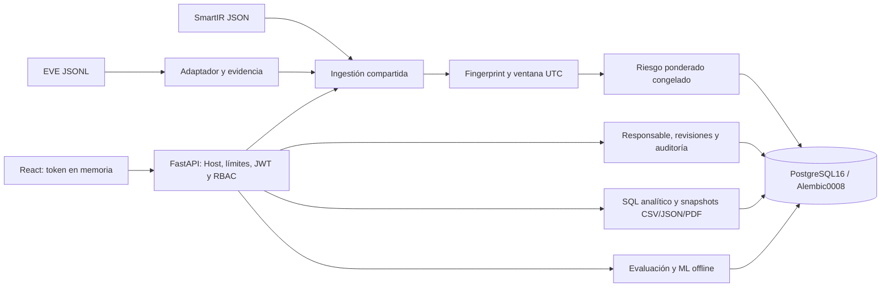

# Validación integral y cierre técnico — iteración 10

Fecha de revisión: **22 de noviembre de 2026, America/Mexico_City**. Los artefactos usan timestamps UTC. Estado: consolidación técnica del prototipo, **antología en revisión, no documento final aprobado**. No certifica seguridad, eficacia IDS, reducción de tiempos humanos ni preparación para Internet público.

## Objetivos, inventario y arquitectura vigente

Se inspeccionaron README, módulos backend/frontend, ocho migraciones, nueve suites anteriores, documentación01–09 y sus resultados versionados. Base de partida Git `db302f0`. Se mantuvieron FastAPI, PostgreSQL 16, SQLAlchemy, Alembic, JWT/Argon2id/RBAC, scikit-learn, React/TypeScript y Recharts. No se reimplementaron algoritmos, no se agregaron tablas/columnas ni se creó0010: **head sigue0008**.



Inventario funcional: autenticación/usuarios (`security.py`, `main.py`); correlación/riesgo (`correlation.py`, `risk.py`, `ingestion.py`); EVE (`suricata.py`, `eve_import.py`); experimentos/métricas (`evaluation_*`, `experiments.py`); ML (`ml_*`); ciclo de vida (`lifecycle*`, `operational_metrics.py`, `risk_audit.py`, `reassessment.py`); analítica/reportes (`analytics*`, `analytical_reports.py`); controles (`abuse.py`, `validation.py`); interfaz en seis módulos TSX. Reportes, evaluaciones y modelos se conservan inmutables según sus contratos anteriores.

Documentación histórica por módulo: [auth](AUTENTICACION_Y_RESPUESTA.md), [correlación](CORRELACION_Y_RIESGO.md), [EVE](INTEGRACION_SURICATA.md), [evaluación](EVALUACION_EXPERIMENTAL.md), [ML](APRENDIZAJE_AUTOMATICO.md), [ciclo](GESTION_AVANZADA_INCIDENTES.md), [analítica](DASHBOARD_Y_REPORTES.md), [seguridad/carga09](SEGURIDAD_Y_RENDIMIENTO.md). Sus resultados siguen siendo históricos, no nuevas ejecuciones10. El inventario exportado registra hashes de código, archivos de migración, resultados anteriores, versiones y casos JUnit.

## Entornos y aislamiento

- Windows10.0.26300, AMD Ryzen5 5600H,12 CPU lógicas, RAM física7,883,206,656 bytes. Host compartido con Docker y servicios habituales activos: no host dedicado.
- Python 3.11.15, SQLite 3.50.4, PostgreSQL 16.16 en contenedor **temporal independiente**, puerto127.0.0.1:55440, DB `smartir_validation`, tmpfs y sin volúmenes del usuario.
- FastAPI 0.165.0, Starlette 1.10.0, SQLAlchemy 2.0.36, Alembic 1.14.0, scikit-learn 1.6.1, pytest 9.0.3, httpx 0.28.1. Node local18.20.8; Compose Python 3.12/Node 22. Docker 29.9.3. Versiones adicionales constan en inventario/lockfiles.
- Playwright 1.61.1, Chromium 149.0.7827.55, headless1440×1100. No Firefox/WebKit, móvil, lector de pantalla ni matriz de sistemas operativos.
- pytest crea archivo SQLite o schema UUID por prueba; únicamente retira su propio schema. Runners HTTP crean archivos/schemas UUID nuevos, secretos/usuarios efímeros y puertos loopback libres. **No aceptan una URL operacional arbitraria**. No leen ni cambian .env del usuario.
- Compose: proyecto nuevo `smartir-iter10-9c8a60d4`, volumen propio, puertos58010/55180. Arrancó/migró, health200 y web200; se detuvo solo ese proyecto y se conservó su volumen. La prueba de navegador usa API/Vite aislados aparte; no acredita navegación del Compose alternativo.

Se preservó el funcionamiento habitual evitando toda conexión/carga/escritura a la BD del usuario. **No se calculó un hash de esa BD ni se realizó una auditoría de sus contenidos**: la conservación se sustenta en aislamiento, ausencia de mutaciones operativas y comprobación exhaustiva de datos de prueba, no en una inspección de información real.

## Casos de integración y matriz final de trazabilidad

Estados: **A**=comprobado automáticamente en el alcance indicado; **E**=ejecución experimental exclusivamente sintética; **D**=diseño/documentación, sin afirmar implementación/validación externa; **P**=pendiente/no probado. No se suman checks HTTP ni assertions a los casos pytest como si fueran pruebas independientes.

Evidencias abreviadas: **J**=inventario JUnit `iter10_validacion_cierre.json`; **H**=`iter10_integral_postgresql_cierre.json` y `iter10_integral_sqlite_final.json`; **B**=`iter10_integral_postgresql_cierre.browser.json`/PNG/reportes; **C**=`iter10_http_concurrent_run1.json/.csv`; **S**=`iter10_compose_smartir-iter10-9c8a60d4.json`. Todos en [resultados](resultados/).

| ID / requisito | Componente | Prueba identificable | Evidencia | Estado y alcance |
|---|---|---|---|---|
| T01 Inventario01–09 y trazabilidad | docs, migraciones, colector | hash por archivo/resultado anterior, matriz presente | J, este documento | A/D; no aprobación académica |
| T02 Arranque y migración | Dockerfile/Compose/Alembic | compose_smoke, upgrades fixture | S/J | A;0008, sin migración nueva |
| T03 Login, JWT, Argon2id, usuario inactivo | security/main | test_api::test_authentication, test_user_management_and_live_permissions; journey | J/H/B | A;3 roles, expiración, hash y permisos vivos |
| T04 SmartIR autorizado | schemas/ingestion | test_api, test_security_controls, journey | J/H/B | A; observador403 |
| T05 EVE parcial/evidencia | suricata/eve_import | test_suricata y journey con línea inválida | J/H/B | A; válidos conservados |
| T06 Fingerprints/duplicados | ingestion | test_temporal_risk, test_suricata, journey repetido | J/H/C | A; huellas históricas/evidencia |
| T07 UTC, límites, IP y tardíos | correlation | test_temporal_risk; journey3 grupos | J/H | A; ventanas fijas, no deslizantes |
| T08 weighted-v2 y explicación | risk | extremos/params congelados; journey factores | J/H | A; pesos de ingeniería |
| T09 Asignación/roles/inactivos | lifecycle | test_lifecycle::test_ineligible_users_and_user_role_race_guard; journey | J/H/B | A |
| T10 Seis estados y auditoría | lifecycle/main | test_machine_rollbacks_reopen_and_assignment_requirements; journey lineal | J/H | A; navegador prueba parte del flujo |
| T11 Acciones/expected_revision | main/lifecycle | test_integral::test_concurrent_transition_and_action_share_revision_guard | J/H/B | A; conflicto409, una revisión ganadora |
| T12 Cierre→nuevo evento→señal | ingestion/risk_audit | test_closed_late_events_freeze_risk_and_signal_review; journey | J/H | A; riesgo histórico idéntico |
| T13 Reapertura/reevaluación | reassessment | test_analytics::test_explicit_reassessment_frozen_parameters_history_and_permissions; journey | J/H | A; evaluación anexa, parámetros congelados |
| T14 Dashboard/filtros/conteos/paginación | analytics | test_analytics agregaciones/denominadores/filtros/N+1 | J/H/B | A; SQL y cohorte común |
| T15 CSV/JSON/PDF | analytical_reports/analytics_api | snapshot inmutable/saneado/sha, botones Playwright | J/H/B, archivos reales | A; sin IP/mensajes/autenticación |
| T16 Evaluación reproducible | evaluation/experiments | test_evaluation; journey seed 202610/60/K 10 | J/H | A/E; no operadores reales |
| T17 ML y comparación mismo test | ml_* | test_ml::test_group_isolation_cv_and_test_support, no_reference*, reproducibilidad; journey96 grupos | J/H | A/E; no despliegue predictivo |
| T18 No calculable/tiempos válidos | operational/evaluation_metrics | test_lifecycle tiempos y evidencia; journey MTTD/MTTR null | J/H/B | A; sin inferir detección desde recepción |
| T19 Interfaz/roles/errores | React/Playwright | integral.spec.ts | B | A;1test, Chromium real;401/409/429 visibles,403/422 también HTTP desde navegador |
| T20 Capturas auténticas | Playwright | screenshot después de autenticación, sin credenciales | B PNG | A; datos sintéticos, no captura PT/IDS |
| T21 HTTP concurrente1/5/10/20 | Uvicorn/abuse/PG | http_concurrent.py con protocolo previo | C | E;320 muestras, cuotas intactas |
| T22 Conflictos asignación/estado/importación | lifecycle/ingestion | test_lifecycle concurrencias; security import concurrente; integral | J | A; no prueba distribuida multiworker |
| T23 Persistencia tras reinicio | runner/DB | hash de todas las tablas antes/después, GET de ML/experimento/reportes tras restart | H | A; copias de prueba completas |
| T24 Upgrade desde versiones previas | migrations/tests | legacy sin Alembic,0002,0003,0004,0005,0006,0007→head; upgrade repetido con ML/reportes | J | A; sin downgrade destructivo |
| T25 Host/CORS/cabeceras/límites | abuse/main/Compose | test_security_controls, snapshot CORS, smoke | J/S | A; configuración local, no proxy externo |
| T26 Avisos de dependencias | npm/pip-audit | consultas finales y resolución transitiva | auditorías10 | A;0 avisos a fecha de consulta, no pentest |
| T27 Compilación e instalación frontend | package-lock/TypeScript/Vite | npm ci y npm run build | J hashes dist, salida documentada | A;442 módulos,4.56 s |
| T28 Guías/antología | docs | revisión contra endpoints/contratos | guías/antología | D; no aprobación final ni ensayo de restore |
| T29 Cinco prácticas Packet Tracer | PRACTICAS_PACKET_TRACER.md | diseños B01/P01–P05 y matrices previstas | documento,0 archivos.pkt | D; implementación/validación P |
| T30 Eficacia real/producción/restauración | fuera de evidencia actual | ensayo humano/red real/restore no ejecutados | ausencia explícita | P; no se afirma cumplimiento |

### Resultados automatizados realmente obtenidos

| Ejecución | Resultado | Duración observada |
|---|---|---|
| Baseline SQLite anterior a nuevos casos |124 passed,0 fallos |78.54 s |
| Final SQLite |**126 passed,0 fallos,0 omitidas** |102.83 s |
| Final PostgreSQL 16 |**126 passed,0 fallos,0 omitidas** |119.27 s |
| Recorrido HTTP TCP PostgreSQL |61 operaciones verificadas, reinicio conserva tablas, modelos/experimentos/exportaciones | Duración exacta en H |
| Recorrido HTTP TCP SQLite |61 operaciones verificadas, misma conservación | Duración exacta en H |
| Playwright final |**1test aprobado**,3 roles,14 checks descriptivos,0erroresJS | Salida real/evidencia B |
| npm ci |66 paquetes instalados,67 auditados | Sin afirmar tiempo de red como build |
| npm run build |TypeScript+Vite correctos,442 módulos |4.56 s,charts437.62kB |
| Compose aislado |build/up,dbhealthy,head0008,health200,web200 | S; no carga ni navegador en ese Compose |
| npm audit / pip-audit resuelto |0 avisos conocidos | JSON conservados, alcance backend+dev resuelto |

Una advertencia por suite: Starlette TestClient depreca integración con httpx y propone httpx2. Se conserva el stack fijado que pasa las regresiones; migrar cliente de pruebas queda pendiente. Tiempos JUnit incluyen fixtures/teardown y pueden diferir levemente del total redondeado de stdout. El pip-audit resuelto consultó72 paquetes (backend, desarrollo y transitivos); consulta versiones obtenidas en esa fecha y no es un lock reproducible completo de dependencias Python. Compose plugin comprobado:5.7.1; el override del arnés requiere soporte de `!override` (Compose2.24.4 o posterior).

## Protocolo y resultados HTTP concurrentes

**Protocolo escrito antes de medir**: [protocol_iter10.json](../benchmarks/protocol_iter10.json), semilla 202610; escenarios separados ingestión/dashboard, clientes1/5/10/20,40 solicitudes cada uno,100 eventos EVE por petición; fixture1000 eventos/100 incidentes de seis tipos. Archivos sintéticos, no capturas IDS. Cada décima petición de ingestión repite la primera de su decena para medir duplicados. Máximo40×100 eventos solicitados por escenario, no todos admitidos. Un esquema/API nuevos por escenario; restart después de fixture, **sin aumentar límites ni resetear contadores durante medición**.

Un solo Uvicorn, concurrencia máxima32, no proxy headers; cuotas import30/usuario/min y2plazas, analytics120/min y4plazas, intactas. Un usuario por escenario, sin elusión por múltiples identidades. No se reintentan429; se verifica Retry-After positivo. Concurrencia cliente limitada por semáforo/pool HTTP; se miden peticiones activas, excluyendo espera del semáforo cliente. Duración total incluye despacho/espera de las40. Throughput=requests/duración (incluye rechazadas); eventos/s=eventos **nuevos confirmados**/duración, excluye duplicados.

Aceptación funcional predefinida:0errores inesperados,0 HTTP503, al menos1éxito por escenario, Retry-After válido, conteo=unión de cargas200más fixture, filas baseline preservadas y p95 de éxitos≤5 s. No define SLO de producción ni porcentaje mínimo de admisión. **Todos esos criterios se cumplieron**, aunque la admisión alta concurrencia es baja. Las latencias de éxito con2–3 muestras tienen incertidumbre grande; no interpretar percentiles como distribución estable.

Cada fila contiene40 solicitudes. Latencias p50/p95/p99 en segundos de **todas** las respuestas; el JSON conserva además series separadas200/429/503 y cada muestra.

| Operación | Clientes |200|429|503/inesperados|Duración s|Req/s|p50|p95|p99|Nuevos/duplicados|Eventos nuevos/s |
|---|---:|---:|---:|---:|---:|---:|---:|---:|---:|---:|---:|
| Ingestión |1|30|10|0/0|4.0538|9.87|.0941|.1942|.2483|2700/300|666.05 |
| Ingestión |5|3|37|0/0|.6411|62.39|.0200|.2487|.4371|300/0|467.92 |
| Ingestión |10|3|37|0/0|.5140|77.82|.0624|.2411|.3741|300/0|583.67 |
| Ingestión |20|2|38|0/0|.6588|60.72|.2399|.3141|.5982|200/0|303.59 |
| Dashboard |1|40|0|0/0|3.5200|11.36|.0739|.1186|.2732|No aplica|No aplica |
| Dashboard |5|20|20|0/0|1.2239|32.68|.1333|.5200|.5358|No aplica|No aplica |
| Dashboard |10|8|32|0/0|.8858|45.16|.1737|.6437|.6464|No aplica|No aplica |
| Dashboard |20|8|32|0/0|.6583|60.77|.2263|.5155|.5202|No aplica|No aplica |

Total: **320 solicitudes,114 éxitos,206 HTTP429,0 HTTP503,0errores inesperados**. Ingestión38 éxitos/122 rechazos,3500 eventos nuevos y300duplicados. Lectura76 éxitos/84 rechazos. El fixture se conserva y los dashboards200 cuentan exactamente1000 eventos. Las pruebas de ingestión pueden actualizar riesgo de incidentes de fixture por compartir atributos/ventana; se verifica que sus eventos originales/fingerprint/asociación permanezcan idénticos, no que el riesgo de un caso abierto quede congelado.

CPU/RSS **no muestreados en el runner HTTP**; no se estiman. Hardware/versiones en inventario. Una ráfaga breve por condición, sin repeticiones estadísticas, sin carga sostenida, múltiples procesos, red remota, TLS o disco operacional. El host tenía otros servicios y el primer escenario coincidió parcialmente con validación de navegador, sin compartir BD. Sin comparación antes/después en10; los pares09 son ASGI y no comparables causalmente a estas latencias TCP. Throughput no es MTTD/MTTR ni eficacia humana.

## Conservación, seguridad e incidencias

El journey guarda hashes/conteos de **todas las tablas** tras crear incidentes, evidencia, asignaciones, acciones, evaluaciones, experimento, dataset, modelo y snapshot. Reinicia Uvicorn manteniendo BD/secreto del runner, compara hashes y vuelve a consultar ML/experimento y cada exportación por SHA. El test_integral además ejecuta upgrade head idempotente y compara filas completas. Las migraciones históricas se ejecutan desde varios estados; no se aplicó downgrade ni cambios destructivos.

Revisión de seguridad: JWT HS256/audiencia/emisor/expiración, Argon2id, rol/inactivo consultados en BD; dependencias por endpoint, mutaciones con actor real/revisión, cuotas y plazas por proceso. Host validado, forwarded headers ignoradas, CORS local, puertos loopback y PostgreSQL no publicado en Compose habitual. Errores422 no reflejan valores; exportaciones saneadas y CSV contra fórmulas. No hubo un nuevo defecto demostrado que requiriera cambiar el backend en10. Persisten limitaciones09: bloqueo de escritura global, métricas legacy costosas, rate limit no distribuido, timeout por lectura de cuerpo y no presupuesto total de transporte.

| Incidencia observada | Corrección o tratamiento | Alcance |
|---|---|---|
| URL backend fija en3 módulos React impide instancia de prueba alternativa | API central en `src/api.ts`, VITE_API_URL opcional, default anterior intacto; proxy solo arnés | Verificado con build y Chromium real |
| Primer journey envió EVE sin Content-Type:415 | Corregido cliente de prueba a application/x-ndjson | No era fallo del adaptador |
| Playwright buscaba Vite bajo tests/node_modules | cwd explícito en configuración | Arnés corregido |
| Selectores exactos de etiquetas con select/textarea y carrera al comprobar acción | Selectores por prefijo; esperar respuesta201 y artículo de timeline | Arnés; no sustituye respuesta real con mock |
| npm ci con esbuild abierto:EPERM; intento build posterior sin tsc | Finalizar ejecución propia y repetir instalación; build correcto luego | Fallos de entorno registrados, sin borrar proyectos/volúmenes |
| Node dentro del sandbox no podía resolver perfil:EPERM | Build autorizado fuera del sandbox | Mismo código/lockfile |
| Primer inventario comparó bytes CRLF de Windows con blob LF de Git | Inventario cierre compara clean-filter Git y publica también hash/igualdad de bytes | `iter10_validacion_final.json` se conserva como preliminar; false no implica modificación histórica |
| Git detectó los PDF nuevos como texto e intentaba normalizar saltos de línea | `.gitattributes` marca PDF/PNG binarios y CSV10 sin conversión; se verifica igualdad de bytes entre archivo descargado e índice Git | Evita alterar offsets PDF y hashes de evidencia; sin regenerar reportes |

Los intentos de navegador fallidos no se cuentan como aprobados; sus capturas parciales permanecen en .test-runs local. Se publican capturas solo de ejecuciones completas aprobadas. El artefacto run5 conserva la primera ejecución completa; cierre verifica además401/429 visibles y publicación tras éxito. Los fallos del arnés no se ocultan como éxitos ni se atribuyen al producto.

La evidencia histórica se compara mediante contenido Git con normalización CRLF/LF; no se reescribieron resultados anteriores. Los hashes crudos de disco se registran aparte. No se publican .env, passwords, tokens, trazas, HAR, storageState ni dumps. Capturas muestran usuarios nominales **de prueba**, no credenciales.

## Procedimiento reproducible y evidencias

Comandos completos y aislamiento: [GUIA_DESPLIEGUE](GUIA_DESPLIEGUE.md). Ejecutar npm ci/build **antes** de abrir Vite/Playwright. Instalar Chromium con `npx playwright install chromium`. Usar etiquetas nuevas para no sobrescribir resultados. No ejecutar el benchmark contra otra URL; el script carece de opción para apuntarlo a un servidor operacional.

```powershell
.venv\Scripts\python -m validation.run_integral --database postgresql --browser --label replica
.venv\Scripts\python -m validation.run_integral --database sqlite --label replica
.venv\Scripts\python -m benchmarks.http_concurrent --label replica
powershell -NoProfile -File validation/compose_smoke.ps1
.venv\Scripts\python backend/app/verify_report.py docs/resultados/iter10_integral_postgresql_cierre.reporte.json
```

Evidencias reales publicadas: resultados JUnit saneados en inventario (nombres/duración por caso),61 checks HTTP por base,hashes/conteos antes/después de reinicio, JSON de navegador, PNG dashboard/incidente, reportes JSON/CSV/PDF descargados, protocolo y320 muestras HTTP CSV/JSON, Compose y auditorías. Los UUID y fecha de generación varían; semillas/fórmulas/expectativas son reproducibles. Los reportes no son byteidénticos entre ejecuciones distintas por esos identificadores/fechas; sí lo son al descargar el mismo snapshot.

No se realizó una campaña manual completa, pentest externo, prueba de restauración, ensayo humano, validación con IDS real o Packet Tracer. Procedimiento manual alternativo: abrir instancia aislada y repetir filas T03–T19 con cada rol; guardar fecha/versión/paso/esperado/observado y capturas solo tras vaciar credenciales; crear dos sesiones para409, esperar expiración para401, provocar entrada inválida desde API para422 y respetar Retry-After para429. Cualquier paso no ejecutado debe seguir marcado pendiente, no completar casillas con resultados esperados.

## Archivos y endpoints afectados, límites finales

Nuevos: `.gitattributes`, `validation/{journey,isolated,run_integral,collect_evidence}.py`, arnés Compose; `benchmarks/http_concurrent.py`, protocolo10; `backend/tests/test_integral.py`; `frontend/src/api.ts`, tipos Vite y tres archivos de pruebas; tres guías/validación y artefactos10. Modificados: main/Evaluation/MachineLearning TSX para URL común, package/lock por Playwright, README, antología y prácticas. **Ningún contrato de endpoint backend cambió**; se ejercitaron importación, auth, incidentes/lifecycle/acciones/reevaluación, analytics/reportes, evaluation y ml. Solo se configuró la dirección cliente, preservando default8000.

Quedan pendientes: implementación/validación real P01–P05; restauración ensayada; navegadores/plataformas adicionales; accesibilidad completa; carga sostenida y múltiple proceso/proxy; control distribuido y transporte de producción; validación IDS/datasets reales autorizados; resultados humanos/estadísticos y aprobación académica. Las métricas sintéticas no solventan esas carencias. El prototipo permanece funcional dentro del alcance comprobado y conserva compatibilidad histórica cubierta por regresiones.
